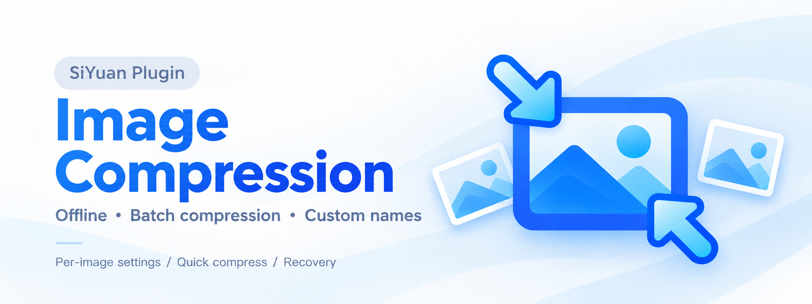
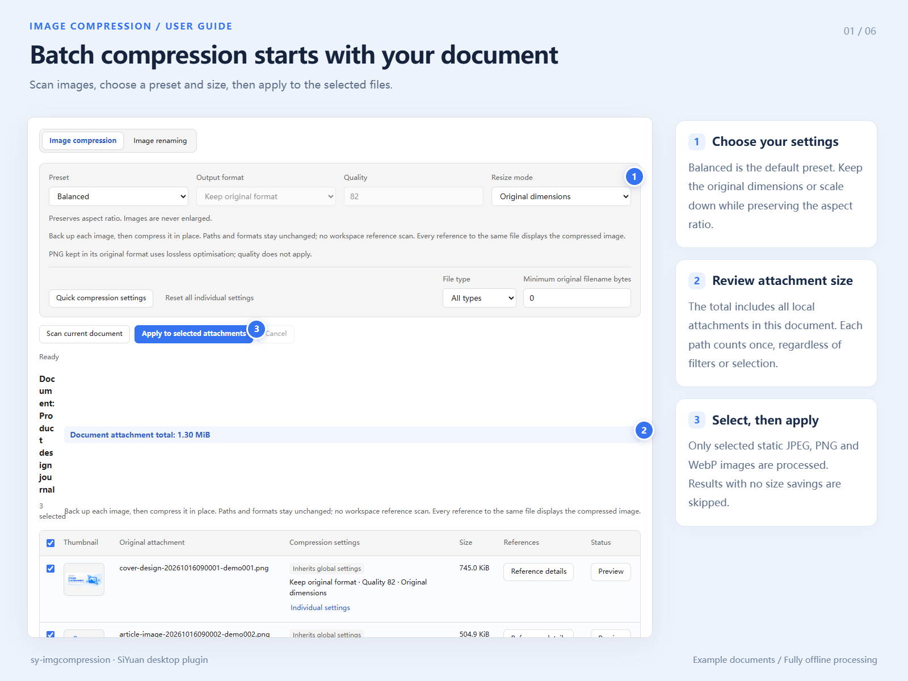
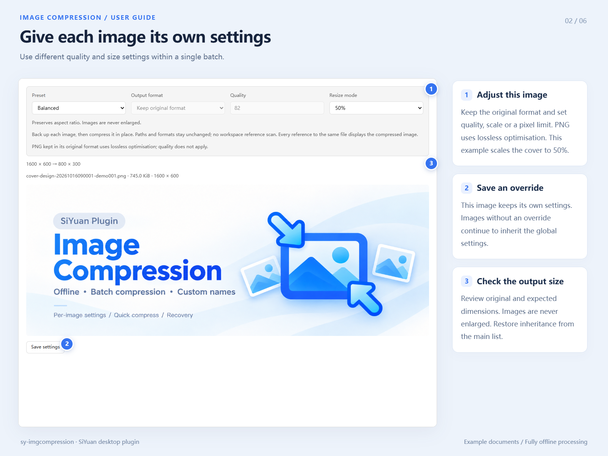
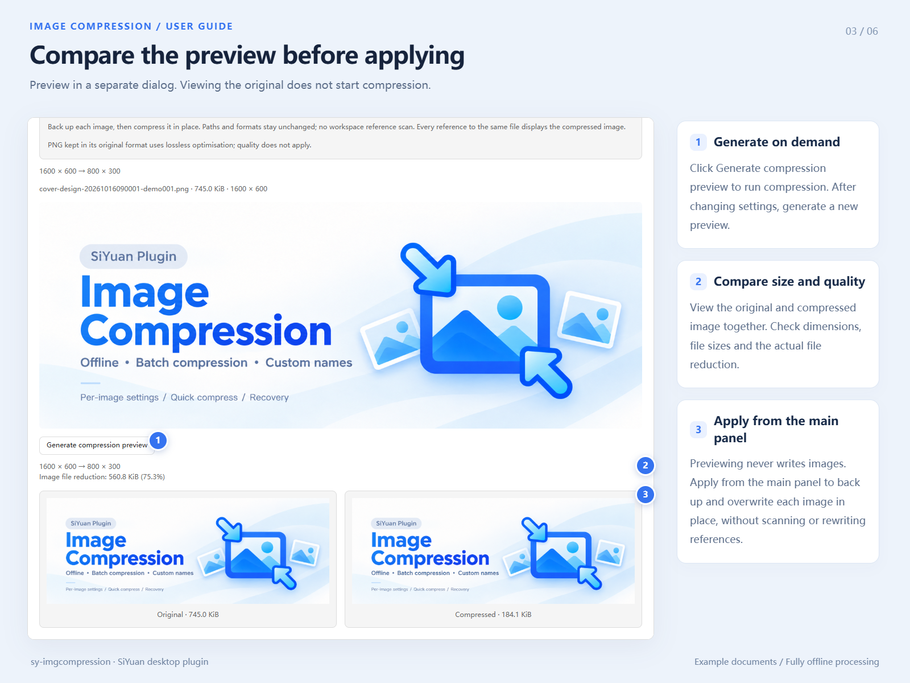
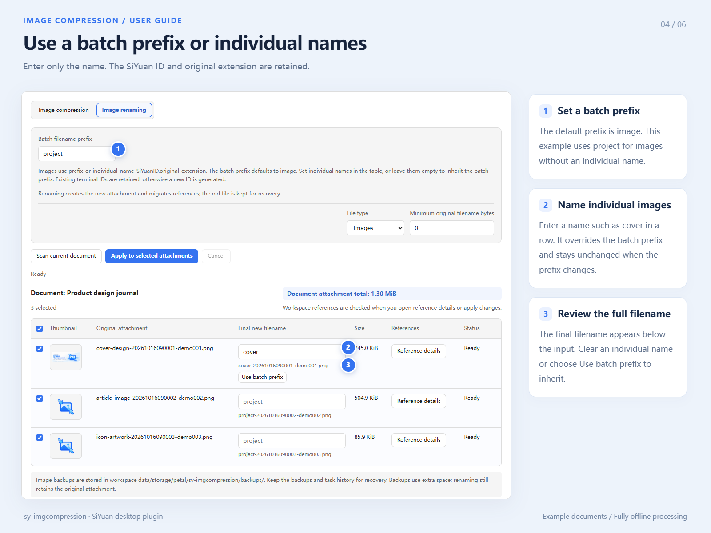
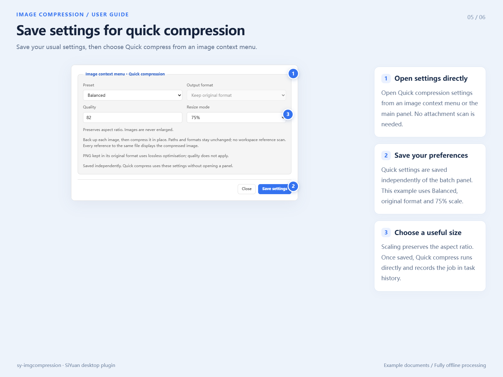
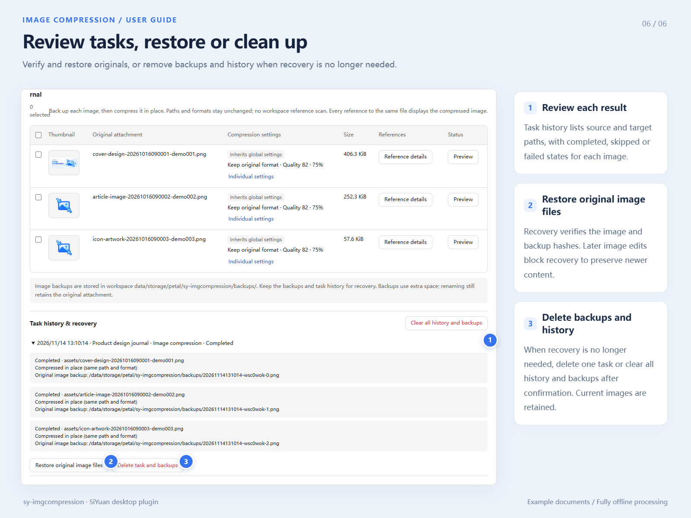

# Image Compression for SiYuan



Offline image compression comes first. An independent image-renaming tab simplifies
image filenames while preserving terminal SiYuan IDs. Desktop SiYuan 3.8.5 or newer is required;
compression backs up and overwrites image files through native file APIs without
workspace reference scans. Renaming requires `findAssetReferences` and `relinkAsset`;
incomplete workspace scans block renaming.

## Install and use

Once listed, search for “Image Compression” in SiYuan Settings → Bazaar → Plugins.
Alternatively, download `package.zip` from
[GitHub Releases](https://github.com/lisontowind/sy-imgcompression/releases/latest). Unzip its contents into
`<workspace>/data/plugins/sy-imgcompression/`, then enable the plugin in SiYuan.
Open a document and use the top-bar image button, the document menu, or commands.
The document title-icon menu and single-document tree context menu show the total size
of all local attachments, with duplicate paths counted once. Filters and selections do
not affect the total; unavailable sizes are reported separately. Empty documents show
zero bytes. The old breadcrumb More menu entry has been removed.
Right-click an image to see its original dimensions and file size, open the panel,
or run Quick compress without a dialog. A separate Quick compression settings dialog
can be opened directly from the image context menu or the panel, without loading the
attachment list. Independent quick settings and global settings
are persisted in `settings.json`; quick compression also uses the durable job journal.

Opening menus, listing or refreshing attachments, and generating compression previews
do not query workspace references. Reference details load on demand for one attachment
and are reused until the next document scan. Single, quick and batch compression and
their recovery never query or migrate references. Renaming and recovery of older
reference-migration jobs still verify fresh workspace references.

Compression supports static JPEG/PNG/WebP and always retains each file's path,
name and original format. A verified backup is saved before a smaller result
overwrites the file; every reference to that file displays the compressed image.
Older WebP-output settings migrate to original format. JPEG/WebP support presets
90/82/70 (default 82), an explicit Custom preset, and optional downscaling. Choose
original dimensions, 75/50/25%, a custom percentage (1–100), or an advanced width,
height or longest-edge limit. All resizing preserves aspect ratio and never enlarges.
Each image can inherit global settings or keep independent settings; global edits do
not overwrite overrides. Reset one or all overrides, or rescan to reset the session.
Thumbnails open original images in child dialogs. Compression preview runs only after
clicking Generate compression preview; changes invalidate the result. Reference dialogs
list locations and embed read-only document content without changing workspace tabs.
Closed notebooks remain closed and their references remain listed.
Original PNG uses lossless byte
optimisation when not resized. Animated images, external URLs, unsupported formats,
images above 50 MiB or 40 million pixels, and results with no savings are skipped.
An image worker is terminated after every image to release its codec memory.

Renaming applies only to images. Set a batch filename prefix (default `image`), or
override the name portion of individual images in the table. Individual names survive
batch prefix changes; clear an individual name or choose Use batch prefix to inherit.
The result is `<prefix-or-individual-name>-<SiYuan ID>.<original extension>`.
The ID and extension are added automatically. Names are kept in the current panel
session; rescanning clears individual names.
A complete terminal ID (14-digit timestamp and seven lowercase letters/digits) is
retained; otherwise a new ID is generated. Already normalized images need no changes.
PDF and other non-image files are excluded. Conflicting destinations are skipped,
never overwritten. Compression does not generate a new attachment name.
Old journals, including document-prefix renames, remain recoverable.

Attachment lists resolve only the current document's files and database assets,
without walking workspace directories. Metadata and path lookups use up to six
concurrent requests and report progress while loading. Deferred assets contribute
to size totals without being downloaded just to populate the list. Ambiguity and
workspace completeness are still checked before applying any changes.

Multi-image renaming uses the kernel's batch API for the baseline, dry run,
migration and final verification: four workspace reference requests per batch.
Files are copied and checked individually to keep image memory bounded. Destination
conflicts are checked without repeatedly listing the whole attachment directory.
Recovery checkpoints are saved by phase. Failure or cancellation verifies and attempts to
restore the affected batch. Older kernels that explicitly reject batch lookups
retain the slower per-image workflow.

Compression streams source images one at a time and releases each Worker after encoding.
Prepared outputs share journal checkpoints at 128 images or 32 MiB, allowing at
most one additional encoded image beyond the byte budget.
Originals are backed up in `data/storage/petal/sy-imgcompression/backups/`; job
records are in the adjacent `jobs.json`. Only after verifying the backup, checking
the original again and persisting recovery information is the image overwritten.
Results without savings create no backup. Progress identifies backup, write and
file verification. Cancellation finishes an active write and verification before
attempting recovery of the current image. No reference API is needed.

Concurrent identical menu totals and metadata share pending reads, with at most
six metadata requests overall and no completed-result cache. Closing a menu or
reference panel cancels its unused reads. Database Markdown is deduplicated per
scan and plain text needs no conversion. Quick single-image compression reads
only that image's size; single-image panels retain document-wide totals.
Name edits, reference detail updates and history refreshes preserve unchanged
rows, thumbnails and expanded history content.

## Illustrated guide

The illustrations below use the actual plugin interface with example documents.
Guide and promotional images are hosted in the repository and require an internet
connection to view. Image compression itself remains fully offline.
The illustrations use the 0.1.8 interface, including original-format compression,
image restoration and backup-history cleanup.

1. Choose batch settings and review attachment totals before applying.



2. Set independent parameters for individual images.



3. Generate a preview explicitly, compare the results, then apply from the main panel.



4. Use a batch prefix or individual names while retaining SiYuan IDs and extensions.



5. Save independent quick settings and compress directly from the image context menu.



6. Review job results and restore original image bytes from verified backups.



## Shared attachments and recovery

Compression updates selected files in place; document, title-image and database
reference paths remain unchanged. Restore original image files verifies the backup
and current image hashes, and refuses to overwrite a later edit or unknown bytes.
Keep both `backups/` and `jobs.json`. Backups are not ordinary unused attachments
and are never deleted automatically.

Expand a task in Task history & recovery to choose Delete task and backups, or
use Clear all history and backups to include older hidden records. Confirmation
removes only the selected records and their generated files in the plugin backup
folder. Current images, references, SiYuan data history and snapshots are retained.
Attachments left in `assets` by older tasks remain managed by SiYuan. Legacy
records can be removed even after unused-asset cleanup deleted their originals.
Deletion gives up recovery for those tasks. Partial failures retain records with
Continue deletion; recovery is disabled once cleanup starts. Cleanup can resume
after reopening, never retries itself automatically, and scans no workspace references.

Writes and restores use SiYuan's native `putFile`, which updates modification time
and marks data for synchronization. Include plugin storage when backing up the
workspace; existing sync/snapshot exclusion rules still apply. Original-image
backups take extra disk and potentially sync/snapshot space. They are distinct
from SiYuan data history. Real two-device synchronization has not been tested.

Renaming copies files to their previewed names and migrates native references
throughout the workspace, including closed notebooks, title images and database
assets. Old unreferenced files are retained for recovery.

For renaming, the kernel migration API reads and updates closed notebooks directly,
without opening/closing them or changing the user's notebook state. It performs
structural reference rewriting, concurrent-write checks and native history backups.
This replaces the planned temporary notebook opening with the kernel's safer native
operation. Ambiguous resource paths, skipped encrypted notebooks (including unlocked
encrypted notebooks), missing database definitions, symlinks, unreadable data and
unsupported references block writes. Unlocking alone cannot make an unsupported
encrypted notebook eligible; resolve that workspace limitation before using this plugin.
Third-party private data and references outside this workspace cannot be migrated.

Jobs are persisted through the plugin's `jobs.json` storage. Execution and recovery
reload the latest journal under a cross-window lock, preserving other windows' jobs.
Failed reads never fall back to a cached journal; saves check the kernel response.
An operation whose result
is unknown after a crash is never replayed automatically. Use **Task history & recovery**.
Recovery of older compression jobs and renames verifies source/target hashes and the reference locations/values before
relinking back; changed or newly added references block recovery rather than overwrite
new edits. Keep the original files until recovery is no longer needed. Cancellation
waits for an in-flight mutation to finish and verifies/reverts the current attachment;
earlier completed attachments remain completed and can be restored from history.
Cancelling a scan or closing its panel aborts read-only requests. Cancelling a
preview also stops its file request and prevents a late compression from starting.

## Development

```sh
npm ci
npm test
npm run build
npm run dev
```

Build output is in `dist/`; `package.zip` has plugin files at the archive root.
Guide and promotional artwork is excluded from the plugin package; `icon.png` and
`preview.png` are retained. Run `npm run package:assets` for the separate artwork archive.
Image processing uses no CDN, external API key or cloud compression. Automatic paste
handling and background original-file cleanup are disabled.
See `THIRD-PARTY-NOTICES.md` and `licenses/` in the package.

For verification results and platform coverage, see `VALIDATION.md` in the source repository.
