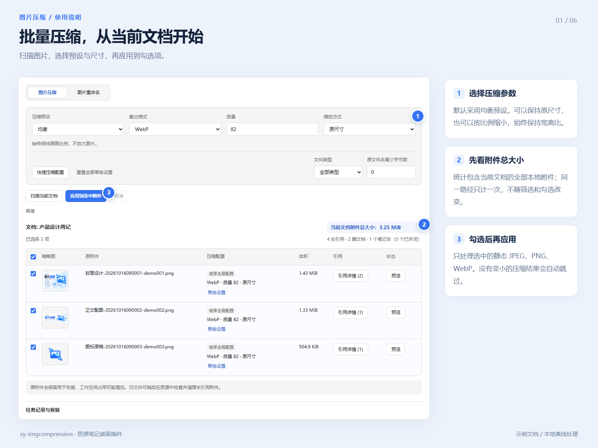
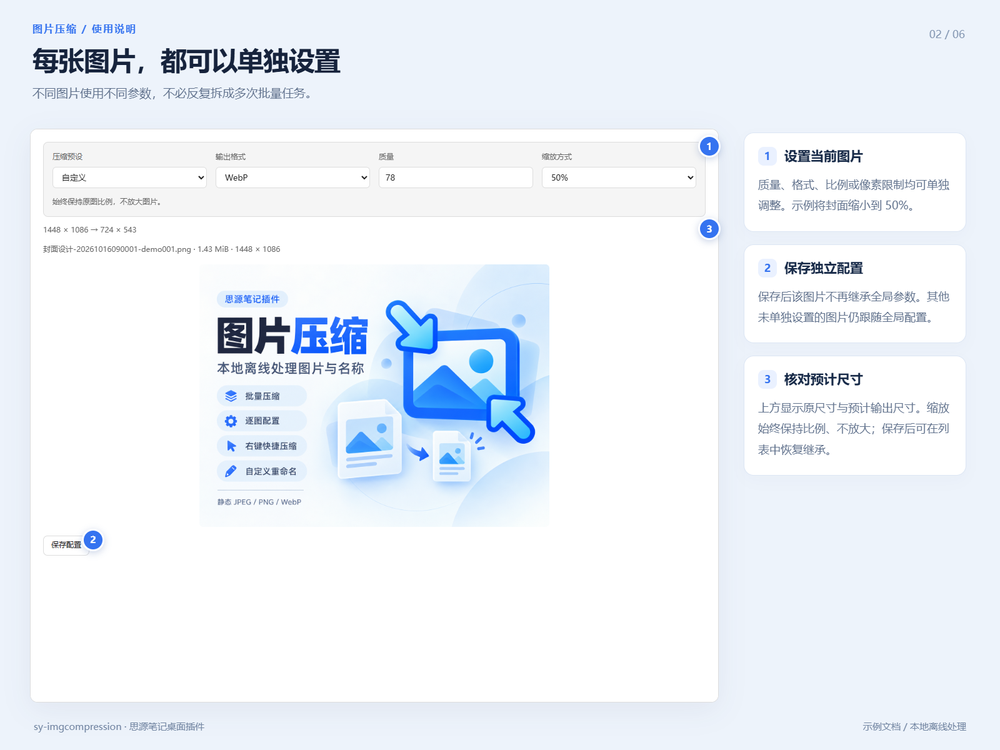
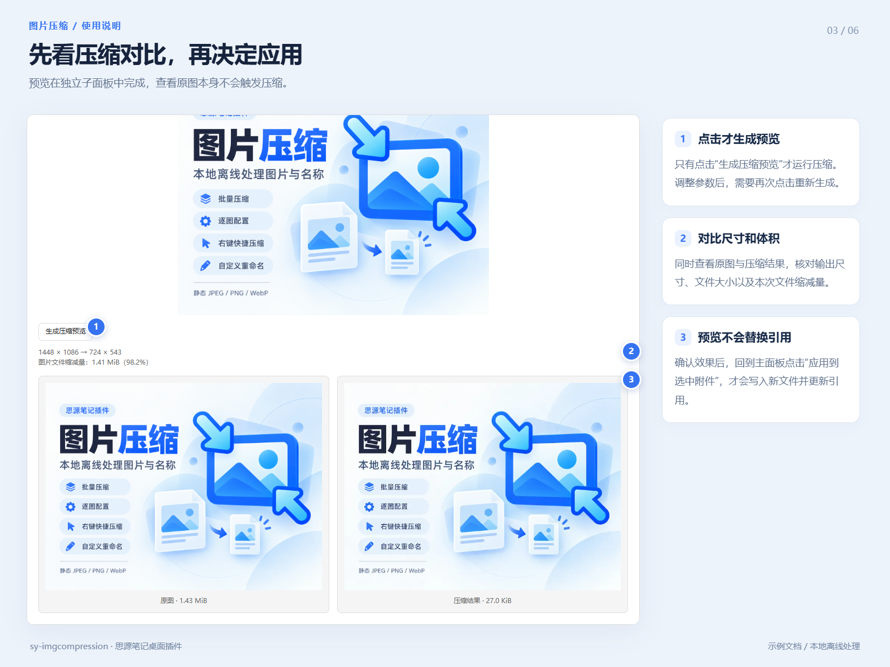
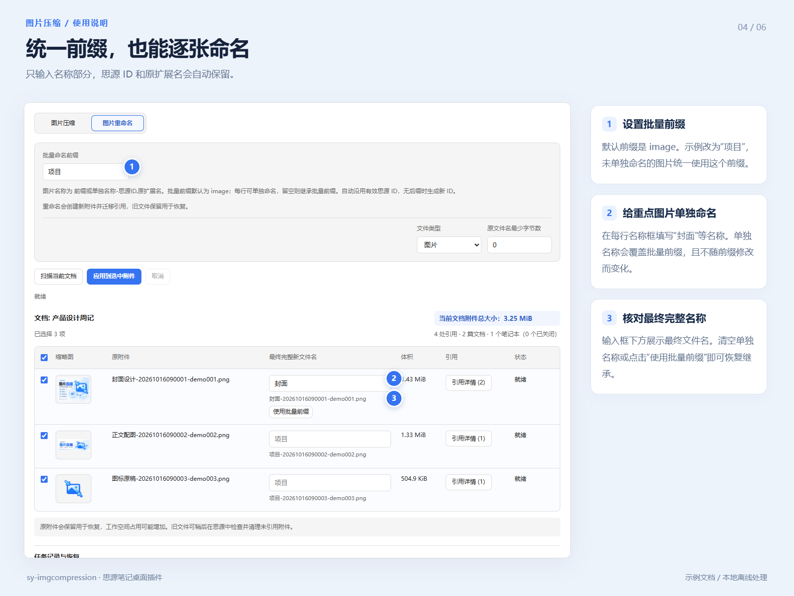
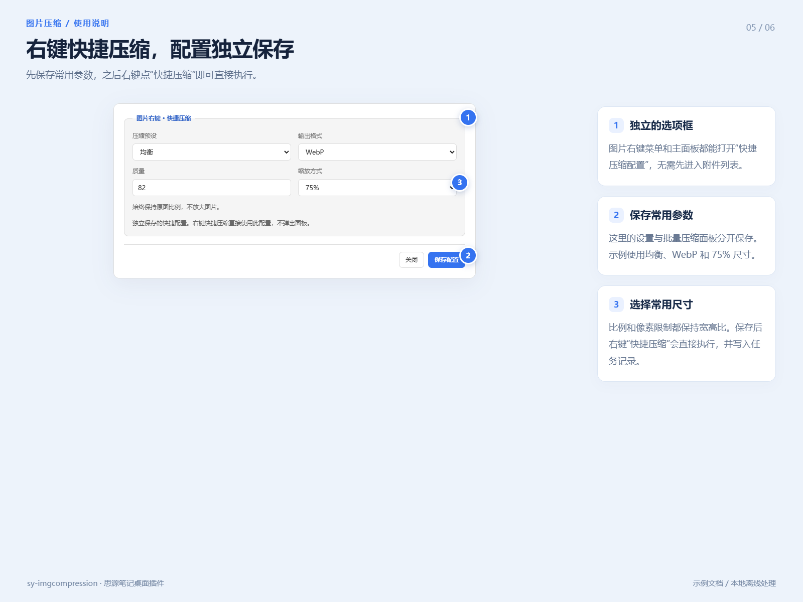
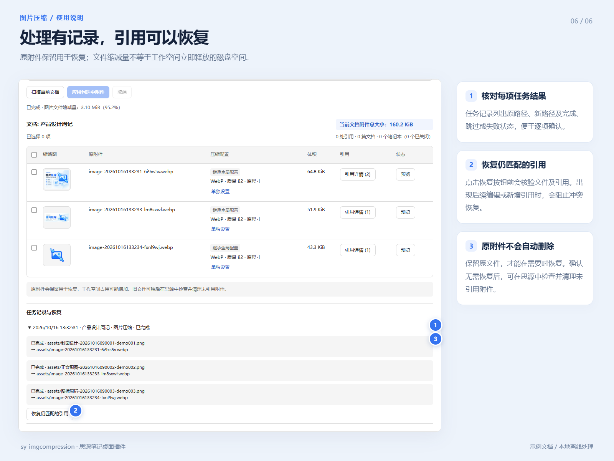

# 思源图片压缩


图片压缩为主功能，图片批量重命名为独立辅助功能。面向桌面版思源 3.8.5 及以上；
内核还必须提供完整的 `findAssetReferences`、`relinkAsset` 接口。缺少接口或无法完整
扫描工作空间时会阻止修改，不会降级为仅替换当前文档。

## 安装与使用

集市收录后，可在思源「设置 → 集市 → 插件」中搜索「图片压缩」安装。
也可从 [GitHub Releases](https://github.com/lisontowind/sy-imgcompression/releases/latest) 下载
`package.zip`，解压到 `<工作空间>/data/plugins/sy-imgcompression/`，
在思源插件设置中启用。打开文档后，可通过顶栏图片按钮、文档菜单或命令面板进入。
文档标题图标菜单及文档树单篇文档右键菜单均提供入口和当前文档附件总大小，
不再加载在“更多”中。总大小包含所有本地附件、同一路径只计一次，不受筛选或勾选影响；
部分大小无法读取时明确标出未统计数量。没有附件时显示正常空状态和 `0 B`。
图片右键显示原始尺寸和文件大小，可打开单图面板、直接快捷压缩，或单独打开“快捷压缩配置”选项框。

图片压缩完全本地离线，支持静态 JPEG、PNG、WebP，默认输出 WebP。预设质量为
90 / 82 / 70，默认 82；自定义预设可独立选择。尺寸默认保持原尺寸，可选 75%、50%、25%
或自定义比例（1–100%）；高级设置可限制宽度、高度或最长边。所有方式保持比例且不放大。
每行可单独设置配置；未设置的图片继承全局配置，独立设置不随全局修改改变。
支持恢复继承及重置全部单独设置；重新扫描会重置逐图配置。
“快捷压缩配置”使用独立选项框，面板按钮及图片右键菜单均可打开，无需先打开附件列表。
配置独立保存，右键快捷压缩直接执行，不打开面板，也写入任务记录。
全局配置与快捷配置保存在 `settings.json`，逐图配置仅保存在当前面板会话。
表格缩略图点击后在独立子面板查看原图。压缩预览同样在子面板中，只有点击“生成压缩预览”
才运行压缩；参数改变后需重新生成。引用子面板支持选择位置并只读阅读对应文档，
不新增主工作区标签。关闭笔记本的引用仍保留条目，但不会自动打开该笔记本。
保持 PNG 且不缩放时直接优化原始 PNG 字节，保留像素、位深和颜色配置。
动图、外链、不支持的格式、超过 50 MiB 或 4000 万像素的图片会跳过；结果没有
比原图更小时不替换。每张图片处理后释放 Worker，避免编码器内存持续积累。

图片重命名支持批量自定义前缀，默认 `image`；每行还可填写单独名称，覆盖批量前缀，
清空单独名称或点击“使用批量前缀”可恢复继承。修改批量前缀不会覆盖单独名称。
最终名称为 `前缀或单独名称-思源ID.原扩展名`，输入框只填写名称部分。
前缀与单独名称保留在当前面板会话，重新扫描会清除逐张名称。识别并沿用文件名末尾的
`14位时间戳-7位小写字母数字` ID，去掉前面的其他名称；无有效 ID 时生成新 ID。
已符合规则的图片无需修改，PDF 等非图片附件不参与重命名。目标冲突时跳过该项，
不覆盖已有文件。新压缩图片使用 `image-新ID.输出扩展名`。
旧任务日志仍可恢复；旧文档名前缀参数只用于历史兼容。

## 图解使用

### 1. 批量压缩

扫描当前文档，选择预设和尺寸，核对附件总大小，再应用到勾选图片。



### 2. 逐图配置

每张图片可以独立设置质量、格式和缩放；保存后不受全局参数修改影响。



### 3. 点击生成压缩预览

先对比尺寸、体积和画面，再返回主面板应用。查看原图本身不会触发压缩。



### 4. 自定义图片名称

统一设置前缀，或逐张单独命名；思源 ID 与原扩展名自动保留。



### 5. 右键快捷压缩

在独立选项框保存常用配置，之后从图片右键直接执行快捷压缩。



### 6. 任务记录与恢复

原文件保留供恢复，文件缩减量不等于磁盘空间立即释放。恢复前会核验文件及引用。



## 共享引用与恢复

当前文档决定选择哪些附件；相同附件在工作空间内的原生引用统一迁移，覆盖关闭
笔记本、题头图、数据库资源字段、PDF 标注和 OCR 元数据。
压缩保留原图；重命名通过复制为预览的新名称再迁移引用实现，旧文件也保留用于恢复。
因此工作空间占用可能增加。插件不会自动删除原附件，可以在确认不需要恢复后使用
思源检查未引用附件。

经核验的内核迁移接口可以直接扫描和更新关闭笔记本，无需临时开关笔记本，因此实现
使用该原生能力，保持笔记本状态。它负责结构化改写、并发校验及原生历史备份。
遇到路径歧义、被跳过的加密笔记本（包括已解锁的加密笔记本）、缺失数据库定义、
符号链接、无法读取的数据或不支持的引用时阻止修改。仅解锁并不能使内核不支持的
加密笔记本参与此迁移。第三方私有数据和工作空间外部引用不在处理范围内。

任务通过插件存储中的 `jobs.json` 持久化。崩溃后不会自动重试结果未知的修改。
可在“任务记录与恢复”中恢复仍匹配的引用；恢复前核验原文件、新文件哈希及引用
位置和值，若出现后续修改或新增引用则停止，不覆盖用户的新编辑。
请在不再需要恢复前保留原文件。取消会等待正在进行的引用更新结束并尝试回退当前
附件，之前已完成的附件仍可从任务记录单独随任务恢复。

## 开发与构建

```sh
npm ci
npm test
npm run build
npm run dev
```

构建结果在 `dist/`，`package.zip` 根目录直接包含插件文件。
不使用 CDN、外部 API Key 或云端压缩，不自动压缩粘贴图片，不后台清理原附件。
第三方声明见 `THIRD-PARTY-NOTICES.md` 及安装包中的 `licenses/`。
测试结果和平台覆盖情况见源码仓库中的 `VALIDATION.md`。
