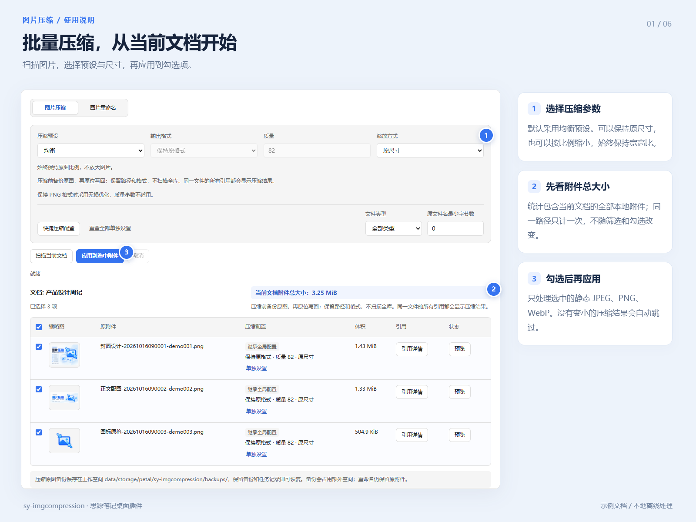
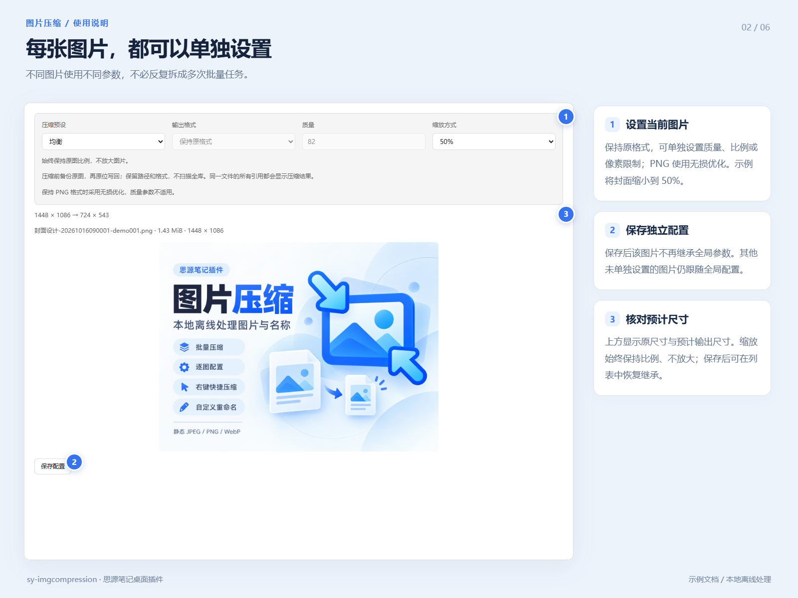
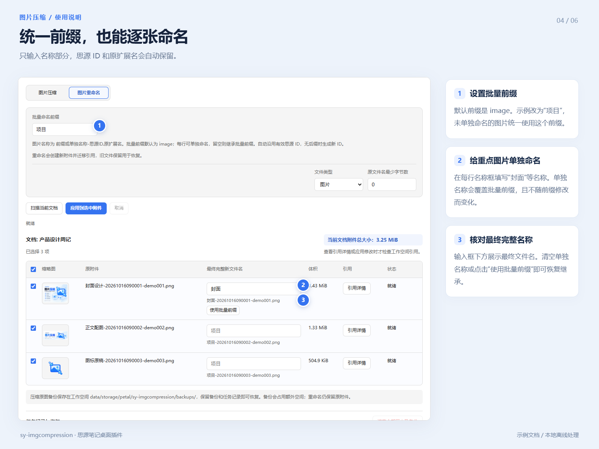
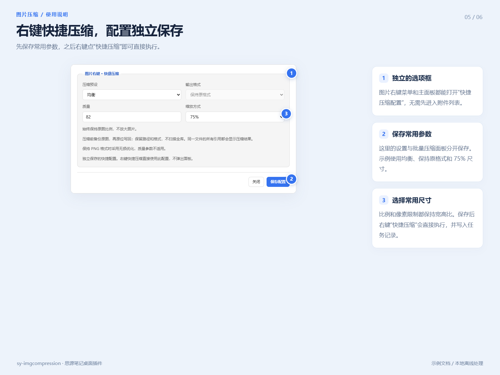
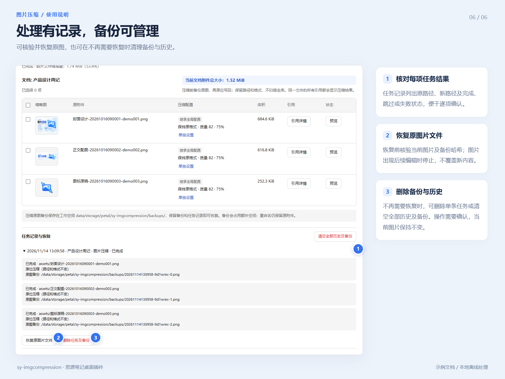

# 思源图片压缩


图片压缩为主功能，图片批量重命名为独立辅助功能。面向桌面版思源 3.8.5 及以上；
压缩通过原生文件接口备份并写回原图片，不需要全库引用扫描。
重命名需要完整的 `findAssetReferences`、`relinkAsset` 接口，无法完整扫描工作空间时阻止重命名。

## 安装与使用

集市收录后，可在思源「设置 → 集市 → 插件」中搜索「图片压缩」安装。
也可从 [GitHub Releases](https://github.com/lisontowind/sy-imgcompression/releases/latest) 下载
`package.zip`，解压到 `<工作空间>/data/plugins/sy-imgcompression/`，
在思源插件设置中启用。打开文档后，可通过顶栏图片按钮、文档菜单或命令面板进入。
文档标题图标菜单及文档树单篇文档右键菜单均提供入口和当前文档附件总大小，
不再加载在“更多”中。总大小包含所有本地附件、同一路径只计一次，不受筛选或勾选影响；
部分大小无法读取时明确标出未统计数量。没有附件时显示正常空状态和 `0 B`。
图片右键显示原始尺寸和文件大小，可打开单图面板、直接快捷压缩，或单独打开“快捷压缩配置”选项框。

读取或刷新附件列表仅解析当前文档及其数据库中的附件，使用内核定位实际文件，不遍历全工作空间目录。
大小和路径查询最多并发 6 个，读取期间显示进度；未下载的附件只统计大小，不为列表主动下载。
打开菜单、读取或刷新附件列表、生成压缩预览均不查询工作空间引用。点击“引用详情”时才查询
该附件的引用，结果仅在当前扫描会话内复用，重新扫描后清除。
单图、快捷、批量压缩及其恢复均不查询或修改引用；只有重命名及旧版引用迁移任务的恢复需要全库核验。

同时打开的相同菜单统计、附件大小和路径等只读请求会共用正在进行的读取，元数据请求总并发不超过 6 个；
请求完成后不保留统计缓存。关闭菜单或引用子面板会取消不再需要的读取。
数据库普通文本不进行 Markdown 转换，相同富文本每次扫描只转换一次，保持附件首次出现顺序。
快捷单图压缩只统计该图片；单图附件面板仍显示整篇文档的附件总大小。

图片压缩完全本地离线，支持静态 JPEG、PNG、WebP，始终保留原文件路径、名称和格式。
先备份原图，再原位写回更小的结果；所有引用同一文件的位置都会显示压缩结果，无需改写文章。
旧版 WebP 输出设置自动改为保持原格式。JPEG/WebP 预设质量为
90 / 82 / 70，默认 82；自定义预设可独立选择。尺寸默认保持原尺寸，可选 75%、50%、25%
或自定义比例（1–100%）；高级设置可限制宽度、高度或最长边。所有方式保持比例且不放大。
每行可单独设置配置；未设置的图片继承全局配置，独立设置不随全局修改改变。
支持恢复继承及重置全部单独设置；重新扫描会重置逐图配置。
“快捷压缩配置”使用独立选项框，面板按钮及图片右键菜单均可打开，无需先打开附件列表。
配置独立保存，右键快捷压缩直接执行，不打开面板，也写入任务记录。
全局配置与快捷配置保存在 `settings.json`，逐图配置仅保存在当前面板会话。
表格缩略图点击后在独立子面板查看原图。压缩预览同样在子面板中，只有点击“生成压缩预览”
才运行压缩；参数改变后需重新生成。引用子面板支持选择位置并只读阅读对应文档，
不新增主工作区标签。关闭笔记本的引用仍保留条目，但不会自动打开该笔记本。
保持 PNG 且不缩放时直接优化原始 PNG 字节，保留像素、位深和颜色配置。
动图、外链、不支持的格式、超过 50 MiB 或 4000 万像素的图片会跳过；结果没有
比原图更小时不替换。每张图片处理后释放 Worker，避免编码器内存持续积累。

图片重命名支持批量自定义前缀，默认 `image`；每行还可填写单独名称，覆盖批量前缀，
清空单独名称或点击“使用批量前缀”可恢复继承。修改批量前缀不会覆盖单独名称。
最终名称为 `前缀或单独名称-思源ID.原扩展名`，输入框只填写名称部分。
前缀与单独名称保留在当前面板会话，重新扫描会清除逐张名称。识别并沿用文件名末尾的
`14位时间戳-7位小写字母数字` ID，去掉前面的其他名称；无有效 ID 时生成新 ID。
已符合规则的图片无需修改，PDF 等非图片附件不参与重命名。目标冲突时跳过该项，
不覆盖已有文件。压缩不会生成新附件名称。
旧任务日志仍可恢复；旧文档名前缀参数只用于历史兼容。

所有压缩逐张读取、编码、备份及校验，并在每张图片后释放 Worker。
待写入结果最多积累 128 项或达到 32 MiB 后提交并合并保存日志，字节预算最多额外包含刚编码的一张结果。
备份保存在 `data/storage/petal/sy-imgcompression/backups/`，任务记录在同目录的 `jobs.json`。
备份写入并核验成功、原图仍匹配且恢复信息已保存后，才覆盖原图片；没有收益则不创建备份。
界面分别显示备份、写回和文件核验进度。取消时会等待已开始的写入和核验结束，再尝试恢复当前图片。

多张图片重命名优先使用内核批量接口，共用引用基线、演练、迁移和迁移后核验，
整批仅需 4 次工作空间引用请求；图片逐张复制和核验，避免同时加载全部图片。
目标冲突先统一筛查，写入前直接检查目标文件，避免逐张重新遍历整个附件目录。
恢复日志按阶段保存；迁移失败或取消后核验并尝试恢复整批引用。
旧内核明确不支持批量查询时沿用逐张处理，仍可能较慢。

## 图解使用

教程截图和宣传图通过仓库链接加载，查看图片需要联网；图片压缩功能仍完全本地离线运行。
教程图使用 0.1.8 界面，包含原格式压缩、原图恢复和备份历史清理。

### 1. 批量压缩

扫描当前文档，选择预设和尺寸，核对附件总大小，再应用到勾选图片。



### 2. 逐图配置

每张图片可以独立设置质量和缩放；格式保持不变，保存后不受全局参数修改影响。



### 3. 点击生成压缩预览

先对比尺寸、体积和画面，再返回主面板应用。查看原图本身不会触发压缩。


### 4. 自定义图片名称

统一设置前缀，或逐张单独命名；思源 ID 与原扩展名自动保留。



### 5. 右键快捷压缩

在独立选项框保存常用配置，之后从图片右键直接执行快捷压缩。



### 6. 任务记录与恢复

压缩前的原图备份用于恢复，文件缩减量不等于磁盘空间立即释放。恢复前会核验当前图片及备份。



## 共享引用与恢复

压缩仅更新选中文件的内容，文档、题头图和数据库等引用路径保持不变；同一文件的所有引用一并生效。
“恢复原图片文件”仅在备份哈希正确、当前文件仍是该任务的输出或已恢复的原图时执行。
图片后来被编辑、备份缺失或结果无法确认时停止恢复，保留任务记录与备份，不覆盖更新后的文件。
请同时保留 `backups/` 和 `jobs.json`；备份不属于未引用附件清理对象，插件不会自动删除。

在“任务记录与恢复”中展开任务，可点“删除任务及备份”；顶部“清空全部历史及备份”包含未显示的更早任务。
确认后只删除所选记录及该任务在插件备份目录中生成的文件，不删除当前图片、文档引用或思源数据历史/快照。
旧版任务在 `assets` 中留下的附件仍由思源管理；即使它们已被“删除未引用资源”清理，也可以删除残留任务记录。
删除后无法再通过这些任务恢复。清理部分失败时保留记录并显示“继续删除”，完成清理前不再提供恢复入口；
重新启动后也可以继续清理，且不会自动重试删除。清理不扫描全库引用。

写回与恢复使用思源原生 `putFile` 接口，由内核更新修改时间并标记同步。
工作空间备份应包含上述插件存储目录；同步/快照是否包含它仍受现有排除规则影响。
原图备份会额外占用本地及可能的同步、快照空间，不能把图片缩减量当作立即释放的空间。
插件备份不等同于思源数据历史，真实双设备同步尚未实测。

重命名通过复制为预览的新名称再迁移工作空间原生引用实现，覆盖关闭笔记本、题头图、数据库资源字段等。
旧附件保留用于恢复；确认无需恢复后，可在思源中检查未引用附件。

重命名使用的内核迁移接口可以直接扫描和更新关闭笔记本，无需临时开关笔记本，因此实现
使用该原生能力，保持笔记本状态。它负责结构化改写、并发校验及原生历史备份。
遇到路径歧义、被跳过的加密笔记本（包括已解锁的加密笔记本）、缺失数据库定义、
符号链接、无法读取的数据或不支持的引用时阻止修改。仅解锁并不能使内核不支持的
加密笔记本参与此迁移。第三方私有数据和工作空间外部引用不在处理范围内。

任务通过插件存储中的 `jobs.json` 持久化。执行与恢复前在跨窗口锁内读取最新日志，
保留其他窗口的任务；读取失败不会使用旧缓存，保存时检查内核响应。
崩溃后不会自动重试结果未知的修改。
旧版压缩及重命名任务仍可在“任务记录与恢复”中恢复仍匹配的引用；恢复前核验原文件、新文件哈希及引用
位置和值，若出现后续修改或新增引用则停止，不覆盖用户的新编辑。
请在不再需要恢复前保留原文件。取消会等待正在进行的引用更新结束并尝试回退当前
附件，之前已完成的附件仍可从任务记录单独随任务恢复。

## 开发与构建

```sh
npm ci
npm test
npm run build
npm run dev
```

构建结果在 `dist/`，`package.zip` 根目录直接包含插件文件。
安装包不包含教程截图和宣传素材，保留 `icon.png`、`preview.png`；
运行 `npm run package:assets` 可单独打包上架素材。
图片处理不使用 CDN、外部 API Key 或云端压缩，不自动压缩粘贴图片，不后台清理原附件。
第三方声明见 `THIRD-PARTY-NOTICES.md` 及安装包中的 `licenses/`。
测试结果和平台覆盖情况见源码仓库中的 `VALIDATION.md`。
